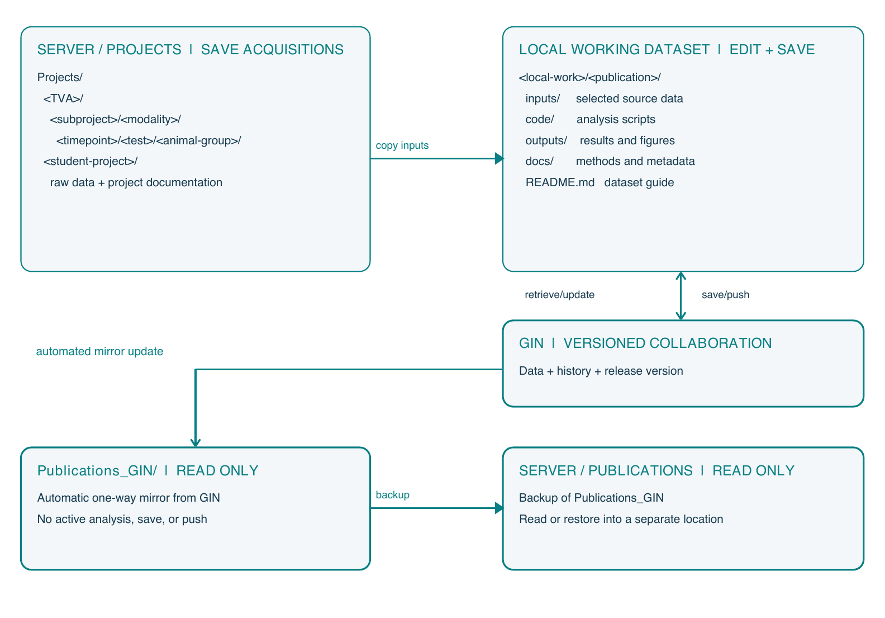
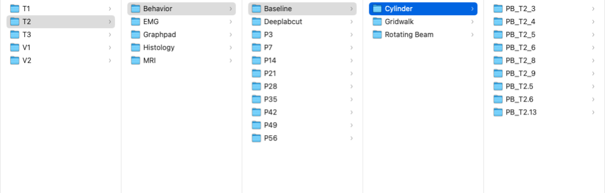
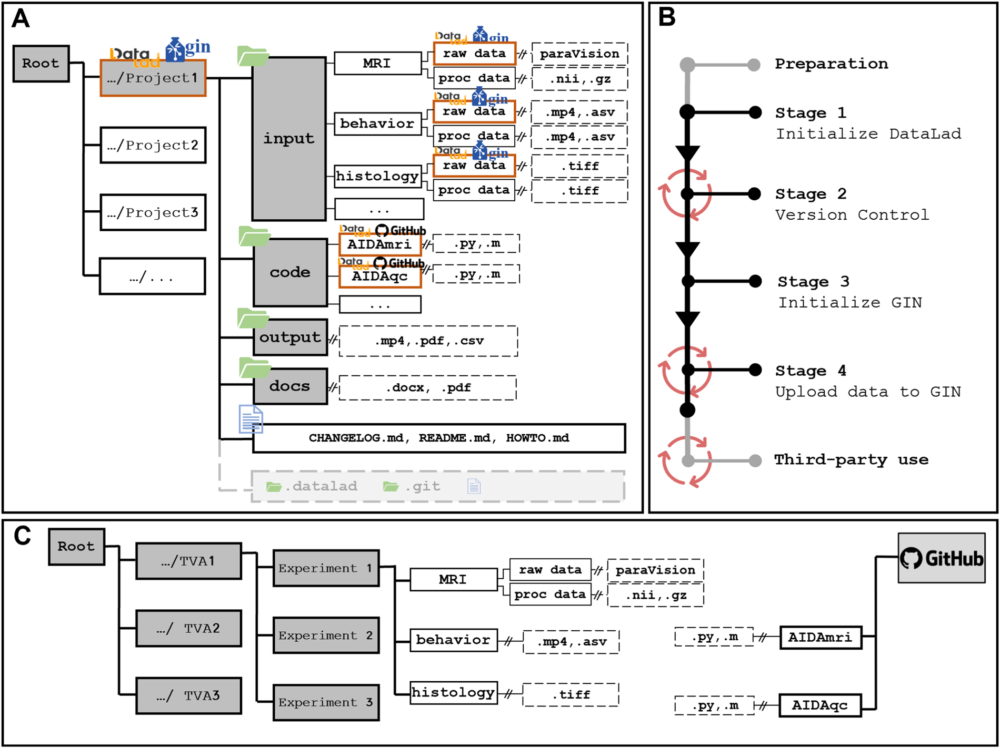
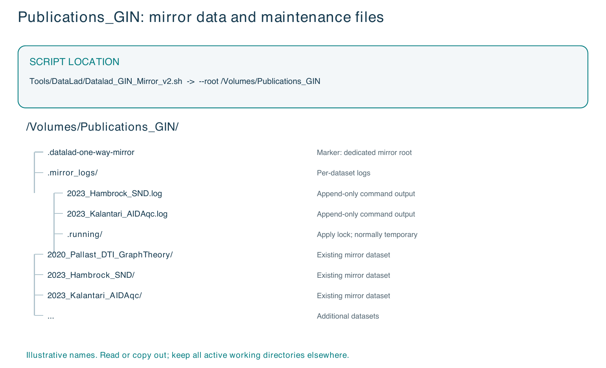

# Aswendt Lab Data Management Plan

Version 1.0 | 23 October 2026 | Draft for lab adoption

Scope: experimental and student-project data, publication datasets, analysis code, GIN synchronization, automated mirroring, and server backup.

## 1. Purpose and storage rules

This plan defines how research data moves from acquisition to a reproducible publication dataset and preserved copies. It builds on the lab SOPs and Kalantari et al. (2023). The storage workflow below reflects the current instructions of the lab lead; older infrastructure descriptions are background rather than the current directory policy. [1-7]

**Core rule:** acquire data into Server / Projects; prepare and analyze publications in a separate local DataLad working dataset; synchronize that working dataset with GIN. The automatically updated `Publications_GIN` drive mirrors and `Server/Publications` are for reading and recovery, not active work.

| Location | Purpose | Researcher actions |
|---|---|---|
| Server/Projects | Primary collection of raw data under TVA folders, plus student-project data | Save new acquisitions and supporting project records here |
| Local working directory | Active publication-specific DataLad dataset, outside mirror and backup locations | Edit, analyze, save, and push to GIN |
| GIN | Shared versioned counterpart of the local publication dataset | Synchronize data and history from authorized local working copies |
| Publications_GIN | Automatically updated one-way mirror from GIN | Read or copy out; never save, push, or develop here |
| Server/Publications | Backup of Publications_GIN | Read files when needed; no editing, saving, or pushing |

Server / Projects and Server / Publications are logical share locations; their exact mounted paths depend on the workstation. They are not assumed to be local `/Projects` or `/Publications` directories.

**Data flow:** acquisition -> Server / Projects -> selected inputs copied to local publication dataset <-> GIN -> automated Publications_GIN mirror -> Server / Publications backup.

The mirror and backup do not receive local changes until those changes have been saved and successfully pushed to GIN. Data that exists only in Projects is not covered by the publication mirror chain.

---

### Folder map: where to work

*Figure 1. Current storage roles. Folder names in angle brackets are examples. Save and push only from the local working dataset; arrows into the mirror and backup are one-way.*

---

## 2. Acquire and organize project data

### Before acquisition

The project lead assigns a responsible researcher, identifies the TVA or student-project directory in Server / Projects, and checks available storage and access. Record the project, subproject, Study IDs, modalities, and timepoints in Ninox or the designated project record. Use the authoritative Study ID already assigned to an animal; preserve blinding of experimental groups. [1,2,6]

### Save each acquisition

1. Save all new experimental data and accompanying acquisition records into Server / Projects. If an instrument requires temporary local storage, treat that as staging and transfer promptly after acquisition.
2. For TVA data, follow the hierarchy: TVA / subproject / modality / timepoint / submodality or cage-group, as applicable. Keep student-project data in its assigned area within Projects and record its relationship to the originating TVA data.
3. Preserve native raw files and complete acquisition folders, including headers, scanner method files, calibration information, and sidecars. Store converted files and analysis outputs separately so that raw files remain identifiable and unchanged.
4. Check the transfer against the acquisition source: file count, total size, representative file opening, and checksums or a transfer manifest where practical. Record acquisition date, operator, destination, and transfer/check outcome.
5. Update the project record with the data location and any missing files, failed acquisitions, or quality concerns. Do not silently remove failed measurements or excluded subjects.

### Names and identifiers

Use `StudyID_Timepoint_Test_AdditionalInformation.ext` where appropriate. Acquisition date may be included; otherwise it must be recorded in metadata. Preserve instrument-generated folder names when needed to retain complete raw acquisitions. [1,2]

Historical SOPs show both hyphenated and underscored IDs. Use the current ID in Ninox and document legacy aliases; do not rename original data merely to match an older example. For BIDS conversion, record an explicit mapping from original IDs to BIDS-compatible labels and validate the converted dataset. [2,6]

Student projects follow the same rules for raw-data preservation, documentation, and handover. A thesis folder or personal laptop must not be the only surviving copy of project data.

**Completion check:** the expected files are present in Projects, metadata identifies the acquisition and responsible person, and transfer verification is recorded. Deleting acquisition-device copies requires confirmation that the applicable backup arrangements are in place; transfer alone does not prove backup.

---

### Raw-data folder example from the SOP

*Figure 2. Extracted unchanged from How_2_Save_data_v1.pdf, page 1 [2]. The screenshot illustrates subproject -> modality -> timepoint -> test -> animal/group folders. It is a historical example; use the current TVA hierarchy and Study IDs in Projects.*

---

## 3. Build and maintain a publication dataset

### Create a local working copy

Create a new DataLad dataset for each publication in a local working directory with sufficient storage, outside `/Volumes/Publications_GIN` and Server / Publications. Give it a stable, descriptive name and record its owner and intended GIN repository. Configure Git identity, DataLad/git-annex, and authorized GIN access according to the DataLad SOP. [5]

Use the YODA organization described in the lab SOPs and Kalantari et al.: `inputs/` for selected source data, `code/` for analysis software, `outputs/` for derived results, and `docs/` for protocols and documentation. Include a root `README.md`. This plan uses these folder names consistently; record any justified project-specific variation. [1,2,6]

Copy the required raw files from Projects into `inputs/`; retain the originals in Projects. Record their source-relative paths, Study IDs, acquisition dates, and checksums where available. Avoid dependencies on personal absolute paths or links into the mirror. An existing publication can be reused as an input, but its repository URL and exact version must be documented.

### Work locally and synchronize with GIN

1. Create the GIN repository with the intended access restrictions and connect it as the dataset's named sibling. Check that the configured destination is correct before the first push.
2. Save selected inputs, code, metadata, and documentation with descriptive DataLad commit messages. A local save records a version; it does not upload content or create a remote backup.
3. Perform analyses in the local working dataset. Retrieve missing annex content when necessary and unlock only files that need editing. Record changes, parameters, software versions, and outputs.
4. Push saved changes and annex content to the configured GIN sibling after meaningful work and before handover. Check command results and resolve failed transfers. A visible repository listing is not proof that every annex file is downloadable.
5. Before resuming work that others may have changed, inspect local status and integrate the remote updates using the agreed collaboration procedure. Resolve conflicts deliberately rather than discarding local work.

The sibling may be called `origin` after cloning or have another configured name. Follow the actual configuration; do not assume a name from an example. For nested datasets, save and synchronize each relevant dataset and its parent references. A parent repository alone does not contain all subdataset content. [5,6]

**Completion check:** the intended commit and required file content are retrievable from GIN in a separate local test clone. Do not use the automated mirror as the test working copy.

---

### Publication organization and version control

*Figure 3. Figure 2 from Kalantari et al. (2023), Scientific Data 10:357, DOI: 10.1038/s41597-023-02242-8 [6], reproduced unchanged under CC BY 4.0 (https://creativecommons.org/licenses/by/4.0/). Panels A and B show publication organization and DataLad/GIN stages; panel C shows TVA-based source storage. The paper uses input/output; this plan uses inputs/outputs. The historical processing layout in panel C is not the current working-directory policy.*

---

## 4. Metadata, quality, and reproducibility

Each publication dataset must explain what it contains and how its reported results were produced. Maintain documentation alongside the data and update it with the analysis rather than reconstructing it only at submission. [5,6]

### Minimum dataset documentation

- **README:** project title, summary, responsible contacts, folder layout, data access/retrieval instructions, associated publication, and instructions for reproducing the main results.
- **Input provenance:** source locations within Projects, Study IDs, acquisition dates, selection criteria, exclusions, and identifier mappings. Keep restricted linking information outside shareable datasets.
- **Data dictionary:** variable definitions, units, allowed values, missing-value conventions, modality descriptions, and interpretation of filenames and timepoints.
- **Methods and quality control:** acquisition and processing protocols, quality checks, known limitations, failed measurements, and reasons for excluding data from an analysis.
- **Computational record:** scripts or notebooks, command sequence, parameters, software and package versions, environment specification or container identity, random seeds where relevant, and links between inputs and outputs.
- **Release information:** repository URL, exact commit or release tag, applicable license, contributors, and persistent identifier when assigned.

Retain native raw formats and use reusable, machine-readable formats for derived data and metadata where feasible, such as CSV/TSV, JSON, and NIfTI with accompanying metadata. Conversion does not by itself prove de-identification or scientific validity. [6]

Version code and small text records in Git and manage large data content through git-annex/DataLad using the dataset's configured policy. Keep passwords, access tokens, SSH private keys, and confidential linkage tables out of all repository history.

### Reproduce before release

A second researcher, or the owner using a separate test clone, checks that required content can be retrieved and a documented representative analysis can run. Compare the resulting output with the expected result and record the test, software environment, commit, and unresolved limitations. For workflows too large to rerun in full, document the tested subset and its limits.

GitHub may host reusable analysis software. Record the exact code commit or release in the publication dataset; if code is a subdataset, save its recorded revision in the parent. Preserve enough environment information to use that revision in future. [4-6]

---

## 5. Sharing, publication, and versioned releases

GIN is the synchronization and data-sharing destination for publication datasets. GitHub can host software and its releases. These services complement the local working dataset; neither replaces acquisition storage in Projects or verified backup. [3-6]

### Release checklist

1. The project lead confirms that the selected files are appropriate for release, consistent with the project permissions, agreements, and any access restrictions. Inspect image headers, sidecars, documents, and metadata for confidential or identifying information before public sharing.
2. Complete the README, contributor and citation information, data dictionary, methods, and license. Choose the data and software licenses deliberately for the project. The license shown in the older GIN SOP is an example, not an automatic license for every dataset. [3]
3. Push the intended data and history to GIN and verify retrieval of required annex content. Check linked code and subdatasets at their recorded versions.
4. Record a stable release commit/tag and, where appropriate, prepare GIN metadata such as `datacite.yml` and use its DOI process. Confirm the release and identifier in the repository rather than assuming that a DOI was created. [3,6]
5. Link the publication, dataset, and software releases in both directions. Record release date, repository URL, commit/tag, DOI if assigned, responsible owner, and verification outcome in the dataset documentation.

Keep restricted datasets private or otherwise access-controlled as agreed for the project. Public release requires a documented decision by the project lead.

### Changes after publication

Preserve published versions. Describe corrections in a changelog and create a new version or release with links to the earlier one. The older GitHub SOP describes deleting and recreating a tag/release; that procedure must not be used to silently replace a version already cited in a publication. Document any exceptional correction explicitly. [4]

At project or student handover, ensure another authorized lab member can access the GIN repository, interpret the documentation, locate the Projects originals, and retrieve the release. Transfer responsibilities and access through the lab process without sharing personal credentials.

---

## 6. Automated mirror, backup, and recovery

### Publications_GIN mirror

`/Volumes/Publications_GIN` is automatically updated from GIN using the one-way mirror workflow. Researchers may read files or copy them into a separate local working dataset. Do not edit or analyze in place, run `datalad save`, push, drop content, or create active project folders there. Unlocked mirror files may be technically writable; this does not make the mirror a working directory. [7]

[`Datalad_GIN_Mirror_v2.sh`](../DataLad/Datalad_GIN_Mirror_v2.sh) fetches existing immediate-child repositories, updates eligible branches, retrieves missing annex content, and optionally unlocks locally available files. It does not clone missing repositories or recursively process subdatasets. New repositories and nested datasets therefore require explicit coverage checks by the mirror administrator. [7]

The administrator reviews `.mirror_logs/<dataset>.log`, `COMPLETE` / `INCOMPLETE`, and `RESULT missing=... batch_errors=...`. Check that every expected dataset actually appears: a selector matching no dataset may still exit successfully. A preview, directory listing, or zero exit code without coverage checks is insufficient evidence that all publications are mirrored. [7]

Apply mode disables the configured push URL for `origin`, but this is not a filesystem permission barrier. Mirror maintenance, stale locks, tracked changes caused by unlocking, or any use of `--discard-local-changes` belong to the administrator. Never apply mirror reset procedures to active working copies. [7]

### Server / Publications backup

Server / Publications stores the backup of Publications_GIN. Use it only to read files if needed or as a recovery source. The backup process must preserve the repository metadata and actual annex content, not merely symlinks or file listings. Verify that `.git`, annex objects, and any required linked content are covered by the selected backup method.

An automatically refreshed mirror is not a historical backup: remote deletions or unwanted changes may propagate. Confirm whether the server backup provides independent historical versions, how long they are retained, and when the last successful backup and restore test occurred. Projects requires its own backup coverage because unpublished raw data does not pass through GIN.

### Recovery and removal

For lost working data, recover into a new local directory from GIN or a verified preserved copy and retrieve the required content; do not turn the mirror or backup into an active dataset. For missing raw data, ask the server administrator to restore the Projects source. Verify restored files and record the incident and recovered version.

Do not force-drop content or delete unique copies to free space. Any cleanup requires verification of retrievable independent copies and the applicable retention decision. The upload helper scripts that perform save/push/drop are not the mirror workflow. [5,7]

---

### Mirror folder structure

*Figure 4. Illustrative layout supported by [Datalad_GIN_Mirror_v2.sh](../DataLad/Datalad_GIN_Mirror_v2.sh). Dataset names are examples, not a verified inventory. The script is maintained separately in Tools/DataLad; it does not need to reside inside Publications_GIN. The .running directory exists only during an apply run unless a stale lock remains.*

Version 2 writes per-dataset .log files. It does not create mirror_summary.csv or missing_files/ metadata/scientific reports; those outputs are not part of this illustration.

---

## 7. Responsibilities and review

### Responsibilities under this plan

- **Acquiring researcher / student:** transfer and verify acquisitions, preserve raw files, maintain metadata, work locally, and save/push publication changes.
- **Project lead / supervisor:** assign storage and dataset ownership, review data selection and quality, authorize releases and retention decisions, and complete handover.
- **Server / mirror administrator:** maintain access and automation, enroll new repositories, check mirror and backup coverage, monitor failures, and document restoration tests.
- **Dataset owner:** keep the README and reproduction instructions current, record release versions, and ensure another authorized person can retrieve the dataset.

Assign named people to these roles for each project; the roles above do not assert that a particular person has already accepted operational duties.

### Review

Review this plan at least annually and whenever storage, synchronization, staffing, or publication requirements change. Record the version, date, changes, and responsible reviewer.

---

## 8. SOPs and supporting references

The four named SOPs and the supporting saving-data guide below are available on Nextcloud under `Administration/SOPs/Software/` and were read from the mounted copy at `/Volumes/LaCie24TB/Nextcloud/`. Use the current approved versions when performing the procedures.

[1] **SOP_ServerStructure_v1.pdf** - server access, TVA/subproject raw-data structure, Study IDs, and YODA project organization; displayed effective date 05/04/2026.

[2] **How_2_Save_data_v1.pdf** - raw-data hierarchy, naming, and copying selected raw data into publication inputs; displayed effective date 11/14/2022.

[3] **SOP_GIN_Upload_v1.pdf** - GIN repository documentation, licensing, upload verification, and DOI context; dated 23 April 2021. Its GIN-client upload route is historical context; this plan uses DataLad for local publication synchronization.

[4] **SOP_Github_Upload_v1.pdf** - software commits, tags, and releases; dated 7 April 2021. Apply the published-version preservation rule in section 5 when using this SOP.

[5] **SOP_AswendtLab_DataLad.pdf** - DataLad v1.0, by Aref Kalantari, Markus Aswendt, and Carolin Hambrock; local creation/cloning, siblings, save/push/get/unlock, and subdatasets. Mirror locations are excluded from its active-work commands.

[6] **Kalantari et al. (2023)**, "How to establish and maintain a multimodal animal research dataset using DataLad," Scientific Data 10:357. DOI: 10.1038/s41597-023-02242-8. Basis for TVA/YODA organization, provenance, DataLad, GIN, and reproducibility.

[7] **Tools/README.md**, **Tools/DataLad/README.md**, and **DataLad/Datalad_GIN_Mirror_v2.sh** - current helper-tool documentation and implementation reviewed for mirror behavior. Current storage roles and automatic updating were specified by the lab lead for this plan.
